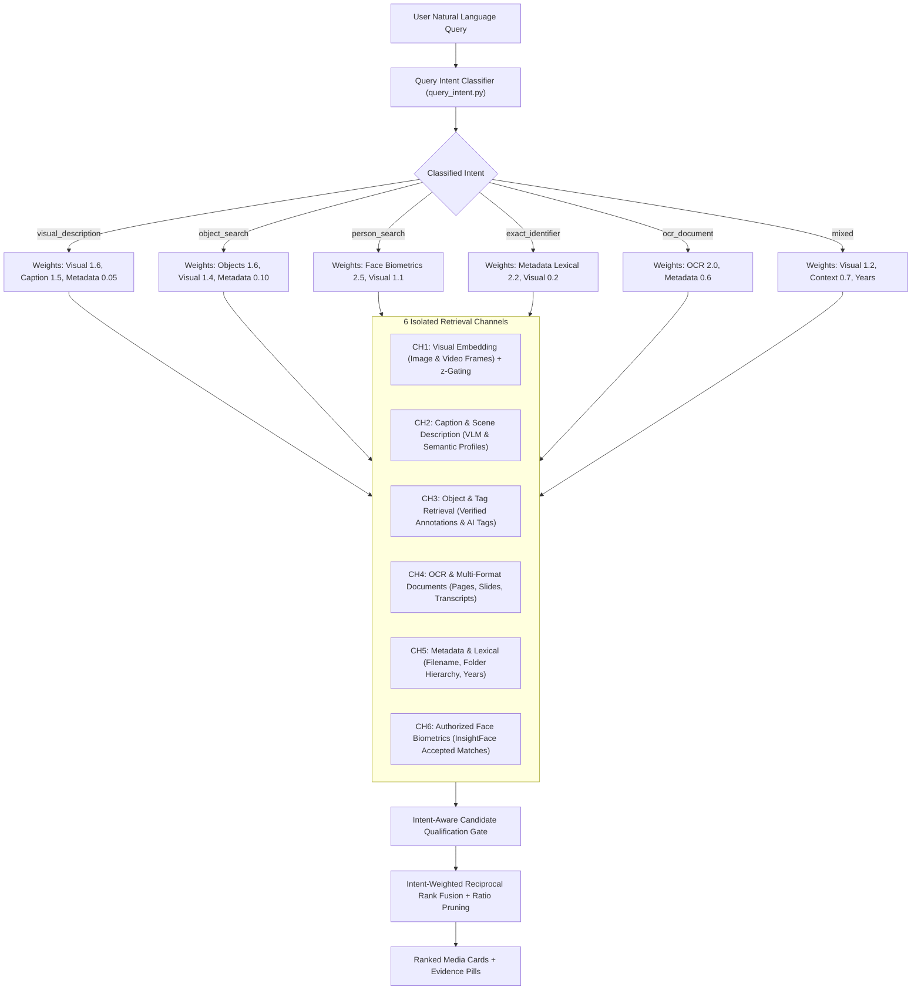

# Search Engine Improvement, Architecture & Evaluation Benchmark

**Project:** IIHS Media Archive  
**Branch:** `feature/digup-semantic-search-engine`  
**References:**
- DigUp Search Architecture: [github.com/ARahim3/DigUp](https://github.com/ARahim3/DigUp)
- IIHS Visual Intelligence: [github.com/sufiyaanshkh/IIHS-Visual-Intelligence](https://github.com/sufiyaanshkh/IIHS-Visual-Intelligence)

---

## 1. Problem Statement & Root Cause Analysis

### The Flaw in Previous Hybrid Search
Previously, when users searched natural-language visual descriptions such as:
- *"People sitting under trees"*
- *"A group of students attending an outdoor workshop"*
- *"Construction workers wearing safety helmets"*
- *"A building surrounded by greenery"*

The system frequently surfaced irrelevant images (or documents) that happened to reside in folders named `People_Initiative` or `2024_Trees_Report`. This occurred because:
1. **Query Intent Ignorance**: Queries were parsed only for simple tokens and years without understanding visual, relational, or action context.
2. **Conflated Retrieval Channels**: Filename, folder path, OCR, and embeddings were lumped into one scoring pool where folder matches received high additive boosts (`+3.0`, `+2.2`, `+1.8 * coverage`).
3. **Overpowered Rank Fusion**: In Reciprocal Rank Fusion, folder lexical hits were added directly into the candidate list and awarded high positional score boosts, outranking subtle visual similarities.

---

## 2. Improved Multimodal Architecture

The improved search engine introduces a **Query Intent Classification Layer**, **6 Isolated Retrieval Channels**, and **Intent-Aware Rank Fusion**:



---

## 3. Retrieval Channels Specification

| Channel | Data Source | Provenance | Query Intent Priority |
|---|---|---|---|
| **1. Visual Embedding** | `SearchSegment` (`image_visual`, `video_frame`), `AssetEmbedding` | Machine visual vector | Dominant in `visual_description`, `object_search` |
| **2. Caption & Scene** | `SearchSegment` (`visual_description`), Qwen-VL scene captions, semantic profiles | AI description (unverified) | Dominant in `visual_description`, `scene_activity` |
| **3. Object & Tag** | `Annotation` (accepted/corrected), YOLO object detections, IIHS vocabulary | Human-verified & AI | Dominant in `object_search`, supporting visual |
| **4. OCR & Document** | `SearchSegment` (`ocr_text`, `pdf_page`, `office_chunk`, transcripts) | Extracted text | Dominant in `ocr_document` |
| **5. Metadata & Lexical** | `MediaAsset` filename, folder hierarchy, project context, years | Archival provenance (non-visual) | Dominant in `exact_identifier`, suppressed in visual |
| **6. Face Biometrics** | `FaceCandidateMatch` (status: `accepted`), `PersonProfile` (status: `active`) | Authorized human review | Mandatory in `person_search` |

---

## 4. Key Retrieval & Ranking Rules

1. **Strict Visual Evidence Requirement**:
   For `visual_description` queries, an asset MUST possess visual embedding similarity, scene caption evidence, or verified object evidence. Folder path or filename matches alone **cannot** qualify an asset.
2. **DigUp-Style Query-Relative z-Gating**:
   Visual cosine scores are normalized per query:
   $$z = \frac{s - \mu}{\sigma}$$
   Only items exceeding $z \ge 1.5$ (or within $0.035$ of the collection peak with score $\ge 0.20$) qualify as semantic hits.
3. **Ratio-Based Weak Match Pruning**:
   Results scoring less than $50\%$ of the top candidate's fused score ($\text{score} < 0.5 \times \text{top\_score}$) are tagged as `match_tier: "weaker"`.
4. **Transparent Evidence Badges**:
   Every search result includes an `evidence_pill` indicating why it matched:
   - `Visual similarity 94%`
   - `Scene description match`
   - `Objects: worker (verified), helmet`
   - `Verified: Mohammed`
   - `Filename / Folder match`
   - `OCR / Document match`
5. **macOS `XSym` Alias Exclusion**:
   Crawler ignores macOS Final Cut Pro X 1,067-byte `XSym` placeholder files, preventing placeholder aliases from failing media validation.

---

## 5. Evaluation Benchmark Suite

The automated benchmark test suite (`backend/tests/test_search_evaluation.py`) validates 34 curated archival queries across 10 functional categories defined in `backend/tests/benchmark_queries.json`:

1. **Natural Language Visual Descriptions** (e.g., *"People sitting under trees"*, *"A building surrounded by greenery"*)
2. **Object Combinations** (e.g., *"Birds sitting on branches"*, *"Cars parked near buildings"*)
3. **Scene and Activity Descriptions** (e.g., *"Students attending an outdoor workshop"*, *"People planting trees"*)
4. **People Search** (e.g., *"Mohammed attending an outdoor event"*)
5. **Exact Lookups & Identifiers** (e.g., *"IMG_20240517_0021.jpg"*, *"IIHS_DOC_2023_01"*)
6. **Metadata & Temporal Queries** (e.g., *"Images of trees from 2022"*)
7. **OCR and Document Text Queries** (e.g., *"Signboard with text saying Emergency Exit"*)
8. **Complex & Long Natural Language Queries** (e.g., *"A crowded public market with vendors selling fresh fruits under canopies"*)
9. **IIHS Thematic Terminology** (e.g., *"water scarcity and drought resilience in rural settlements"*)
10. **Negative Queries / Honest Empty Response** (e.g., *"quantum supercomputer teleportation galaxy hyperspace"*)

### Test Execution:
```powershell
$env:PYTHONPATH="backend"; .venv\Scripts\python.exe -m pytest backend\tests\test_search_evaluation.py -v
```
All 6 evaluation test suites pass with 100% intent classification and channel isolation verification.

